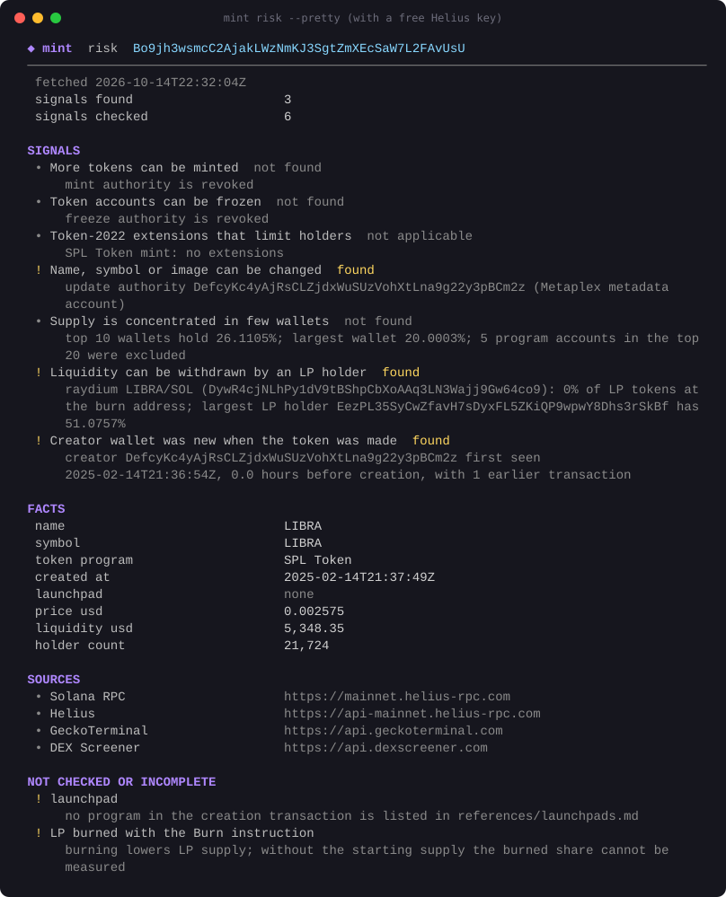
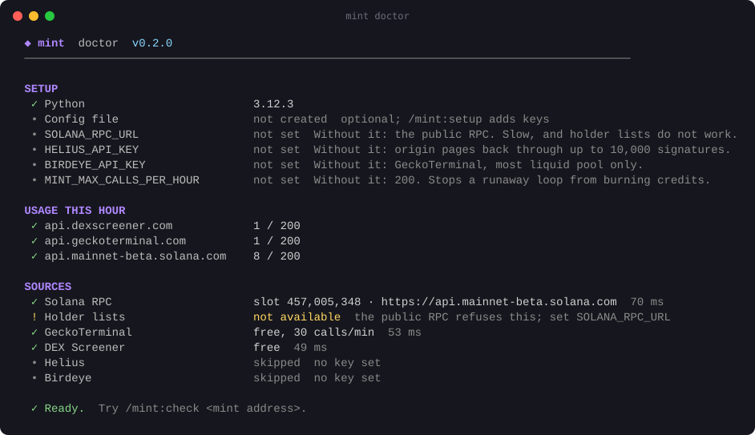

<div align="center">

# mint

**Ask Claude about any Solana token. Get facts, sources, and what could not be checked.**

[](https://github.com/KevinGod1234/mint/releases)
[](LICENSE)
[](#requirements)
[](#requirements)
[](#safety)

A Claude Code plugin that looks up what a token is, who made it and where,
how its price and liquidity developed, who holds it, and which risk signals
it shows. Read-only, free sources by default, no advice.



</div>

## Install

In Claude Code:

```
/plugin marketplace add KevinGod1234/mint
/plugin install mint@mint
```

Then ask a question, or use a command:

```
/mint:check DezXAZ8z7PnrnRJjz3wXBoRgixCa6xjnB7YaB1pPB263
```

That is all. No keys needed to start.

## Commands

| Command | What you get |
| --- | --- |
| `/mint:check <mint>` | The full picture: what the token is, origin, liquidity, holders, risk signals with evidence, and what could not be checked |
| `/mint:price <mint> [interval]` | Price history, change over the range, highs and lows, and whether they reach back to launch |
| `/mint:creator <mint>` | The creator's other coins and how each stands now, and when the creator sold or moved this one relative to its peak |
| `/mint:outcomes <mint>` | What happened to the pump.fun coins you looked up, at 1, 7 and 30 days: how many graduated and how many still traded, with sample sizes |
| `/mint:holders <mint>` | Largest holders and their share, with pools and vaults kept apart from wallets |
| `/mint:setup` | Creates your private keys file and shows how to add keys |
| `/mint:doctor` | Checks every data source, your keys, and this hour's request budget |

You can also just ask: *"what is this coin?"*, *"who created it?"*,
*"is the liquidity burned?"*, *"what did the price do this week?"*. Claude
picks the right lookup.

## What it can and cannot tell you

It does not have all information. Some data needs a key, and some is not
available from any free source. Every answer lists what is missing and why.

| Question | Without keys | With keys |
| --- | --- | --- |
| Name, symbol, supply, decimals | Yes | |
| Mint and freeze authority, Token-2022 extensions, editable metadata | Yes | |
| Current price, FDV, market cap | Yes | |
| Pools, liquidity, LP model, fully burned LP | Yes | |
| Holder count, top-10 share (pools included) | Yes, once GeckoTerminal has indexed the token | |
| Creator, creation time, launchpad | Young tokens only. Older ones stop after 10,000 transactions | Yes, with Helius |
| Creator's other coins, creator sells | No. Creator, peak and current balance only | Yes, with Helius |
| Price and volume candles | Past 180 days, most liquid pool | All pools, with Birdeye (depth not yet verified) |
| All-time high and low | Only for tokens under 180 days old, one pool | Possibly, with Birdeye |
| Top 20 holders, pools labelled | No. The public RPC refuses the call | Yes, with a private RPC |
| Who holds the LP tokens | No. Same reason | Yes, with a private RPC |
| Holder concentration and unlocked-liquidity signals | Not checked | Yes, with a private RPC |
| Past market cap | No source for it | No source for it |
| Wallet clustering, insiders, bundles, LP lockers, socials | Not supported | Not supported |

A free [Helius](https://www.helius.dev) account gives both a private RPC and
a Helius key, which fills most of the gaps.

## Your samples stay on your computer

Each `/mint:check` and `/mint:creator` lookup saves the coin's address and
creation time to `~/.config/mint-solana/samples.jsonl` (readable only by
you). `/mint:outcomes` re-checks those coins at 1, 7 and 30 days and shows
what happened to the coins *you* looked up. The file never leaves your
computer. Delete it at any time.

## Add keys (optional)

Run `/mint:setup`. It creates `~/.config/mint-solana/.env`, readable only by
you, and tells you what to put in it. Open it in any editor, paste the values,
save, then run `/mint:doctor`.

| Variable | Adds |
| --- | --- |
| `SOLANA_RPC_URL` | Holder lists, LP holders, faster lookups |
| `HELIUS_API_KEY` | Full history for creator and launch lookups |
| `BIRDEYE_API_KEY` | Price across all pools |
| `MINT_MAX_CALLS_PER_HOUR` | A different safety budget (default 200) |

Never paste a key into a chat with Claude. The plugin tells Claude to refuse
keys, and Claude never reads the keys file. Environment variables with the same
names also work and take priority over the file.

## Safety



- **Read-only.** Nothing signs or sends a transaction, or touches a wallet.
- **Request budget.** Every request counts against a shared budget: 200 per
  source per hour by default. When it runs out, lookups stop with a clear
  message instead of calling the source. If Claude ever loops, this keeps your
  IP from being blocked and your paid API credits from burning.
- **Per-run cap.** One lookup makes at most 150 requests.
- **Bounded retries.** At most 6 attempts per request, with backoff.
- **Typical cost.** A full `/mint:check` makes about 10 to 20 requests.
- **Facts, not advice.** Claude is told never to say buy, sell, safe or scam,
  or to predict prices. A risk signal is evidence, not a verdict.

## How it works

```
/mint:check <mint>
      |
      v
  bin/mint risk  -->  overview   mint account, Token-2022 extensions, metadata   (Solana RPC)
                 -->  origin     first transactions, launchpad, creator          (Solana RPC or Helius)
                 -->  holders    largest accounts, holder count                  (Solana RPC, GeckoTerminal)
                 -->  pools      pools, liquidity, LP tokens                     (DEX Screener, Solana RPC)
      |
      v
  one JSON object: data, sources, missing  -->  Claude writes a plain summary
```

Small Python scripts, standard library only. Each prints one JSON object with
its data, its sources and what it could not check. The scripts never
interpret; Claude does, following the wording rules in `skills/check/SKILL.md`.

Launchpads detected: pump.fun, Raydium LaunchLab (incl. letsbonk.fun),
Meteora Dynamic Bonding Curve, Moonshot. Pools understood: PumpSwap, Raydium
AMM v4, CPMM and CLMM, Orca Whirlpools, Meteora DLMM, DAMM v1 and v2.

Field meanings: [`references/reading-results.md`](references/reading-results.md).
Data sources, limits and terms: [`docs/sources.md`](docs/sources.md).

## Use without Claude

Every lookup runs on its own. Add `--pretty` for the view shown above.

```
git clone https://github.com/KevinGod1234/mint
cd mint
bin/mint risk <mint> --pretty
bin/mint history <mint> --interval 1d --limit 180 --pretty
bin/mint doctor
```

`bin/mint help` lists every command. `NO_COLOR=1` turns colors off.

## Requirements

Python 3.8 or newer. Nothing to install: standard library only.
Tested on Linux (WSL). macOS and Windows have not been tested yet.

## Develop

```
python3 -m unittest discover tests                    # offline, saved responses
MINT_MAX_CALLS_PER_HOUR=1000 python3 tests/live.py    # every lookup against tests/tokens.md
```

All terminal colors live in one place: `PALETTE` in `scripts/common.py`.

## Upgrading from solana-token-intel 0.1

The plugin was renamed. Remove the old one and add the new one:

```
/plugin uninstall solana-token-intel@solana-token-intel
/plugin marketplace remove solana-token-intel
/plugin marketplace add KevinGod1234/mint
/plugin install mint@mint
```

Keys saved by 0.1 are still read. The Artist Passport lookup was removed.

## License

[MIT](LICENSE)
